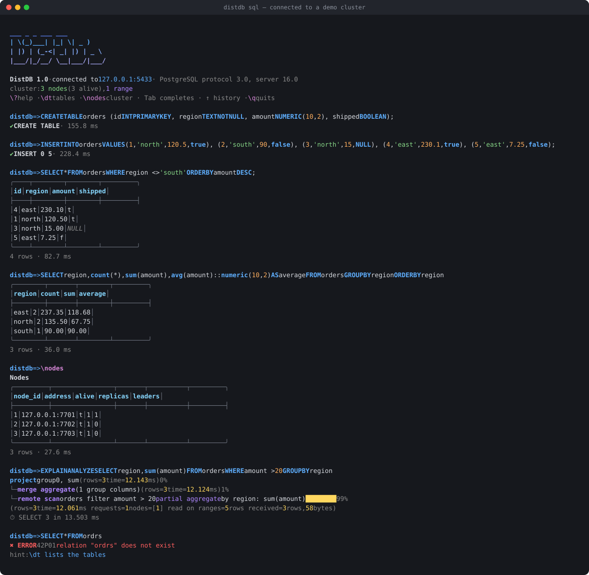
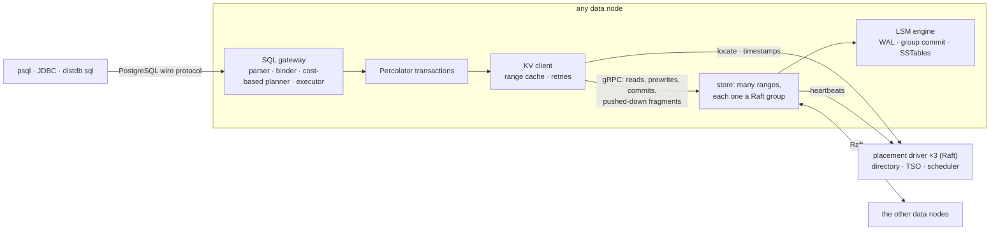
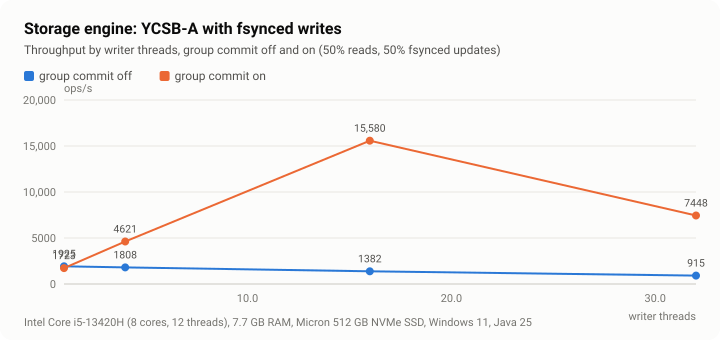
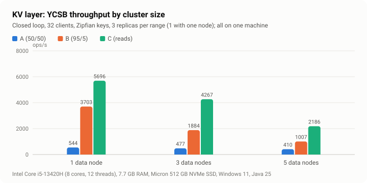
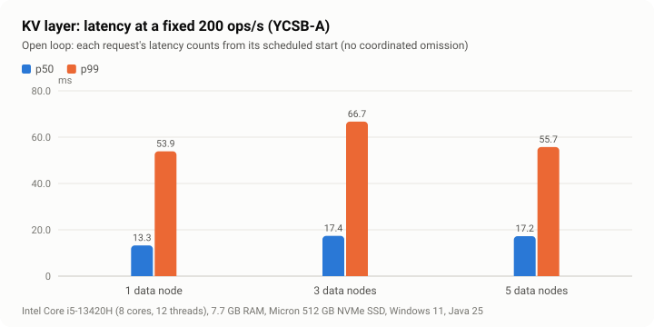
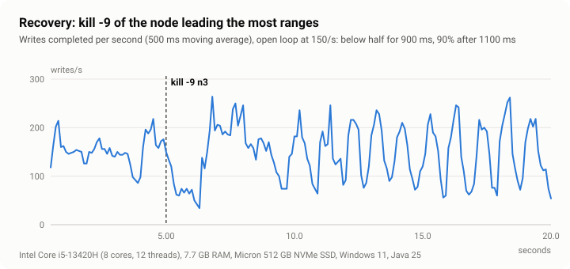
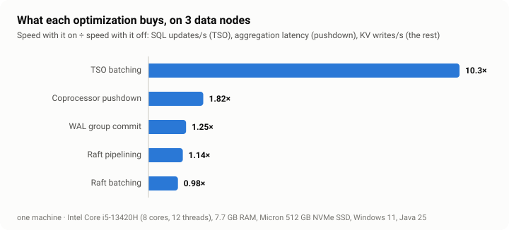

# DistDB

A distributed SQL database in Java 25, built from scratch as a learning project:

- **Storage:** data is split into ranges, and each range is replicated three ways with Raft, on an
  LSM storage engine.
- **Transactions:** Percolator-style transactions give snapshot isolation across ranges.
- **SQL:** a cost-based planner pushes filters and aggregates down to the ranges, and any node
  speaks PostgreSQL's wire protocol.
- **Testing:** every layer was proven in a deterministic simulator, then on real processes with
  injected faults.

(DistDB is a placeholder name.)

<p align="center"></p>

## Quick start (five minutes)

**Without Docker:** a whole cluster in one process, and the shell.

```bash
./gradlew :distdb-server:installDist
```
```bash
distdb-server/build/install/distdb/bin/distdb demo
```

**With Docker:** three placement-driver nodes and five data nodes, each in its own container.

```bash
./gradlew :distdb-server:installDist
```
```bash
docker compose up -d --build
```
```bash
distdb-server/build/install/distdb/bin/distdb sql 127.0.0.1:5433
```

Any PostgreSQL client works as well: `psql -h 127.0.0.1 -p 5433 -U distdb` (no password). Then:

```sql
CREATE TABLE accounts (id INT PRIMARY KEY, owner TEXT NOT NULL, balance INT NOT NULL);
INSERT INTO accounts VALUES (1, 'ann', 100), (2, 'bob', 50), (3, 'cy', 75);
BEGIN;
UPDATE accounts SET balance = balance - 30 WHERE id = 1;
UPDATE accounts SET balance = balance + 30 WHERE id = 2;
COMMIT;
ANALYZE;
EXPLAIN ANALYZE SELECT owner, sum(balance) FROM accounts GROUP BY owner;
\ranges accounts
\nodes
```

Each node has a page for people at `http://127.0.0.1:8081/debug` (8081–8085 for the data nodes,
8091–8093 for the PD), and Prometheus metrics at `/metrics`. With Docker, Grafana's live
dashboard of the whole cluster is at http://localhost:3000.

## How it fits together



A statement arrives at any node. The node plans it and runs it as a transaction, using
timestamps from the PD's oracle. Each read and write goes to the leader of the range that holds
the key. Filters, projections and partial aggregates run on the ranges themselves, and the
gateway merges what they send back. The PD splits ranges that grow, moves replicas to balance the
nodes, and replaces the replicas of nodes that die. The design notes in
[`docs/design/`](docs/design/) explain each layer. [`docs/phases.md`](docs/phases.md) is the plan
and what each phase proved. [`docs/journal.md`](docs/journal.md) is the log of every bug and
surprise.

## The shell

`distdb sql` is an interactive client that speaks PostgreSQL's protocol, so it also works against
PostgreSQL itself.

- **Typing:** syntax highlighting as you type; Tab completes keywords, tables, columns and
  commands; history is kept across sessions in `~/.distdb_history`. A statement continues across
  lines until its `;`.
- **The prompt** shows the transaction's state: `distdb=>` when idle, `distdb*>` inside `BEGIN`,
  `distdb!>` after an error.
- **Results:**
  - tables with numbers right-aligned and NULLs dimmed, with the row count and the time;
  - one column per line (`\x`) when a result is too wide for the terminal;
  - `EXPLAIN ANALYZE` as a tree, with each operator's own share of the time as a bar;
  - errors with their SQLSTATE and a hint.
- **Commands:** `\dt` tables · `\d TABLE` columns and indexes · `\di` indexes · `\stats TABLE`
  statistics · `\ranges [TABLE]` where the data lives · `\nodes` the cluster · `\pushdown on|off`
  · `\timing` · `\x` · `\i FILE` · `\conninfo` · `\?` · `\q`.
- **Scripts:** with `-c SQL`, `-f FILE` or piped input, it prints psql's plain format, without
  colors, and stops with exit status 3 at the first error.

The commands are backed by SQL that any client can run: `SHOW TABLES`, `SHOW COLUMNS FROM t`,
`SHOW INDEXES FROM t`, `SHOW STATISTICS FOR t`, `SHOW RANGES [FROM TABLE t]` and `SHOW NODES`.

## Benchmarks

All numbers come from one laptop: Intel Core i5-13420H (8 cores, 12 threads), 7.7 GB of RAM, a
Micron 512 GB NVMe SSD, Windows 11, Java 25. Every process of the cluster shares those cores and
that disk, so "3 nodes" and "5 nodes" here measure the cost of coordination, not scale-out. The
plan called for a few runs on cloud VMs; there were none. Results, charts and how to rerun them:
[`docs/bench/`](docs/bench/), and `distdb-bench all` (see the Phase 10 design note).

**Read this first: every write costs fsyncs, and an fsync costs about 2 ms here.**
- A write is fsynced twice on each replica: once in the Raft log, once when it is applied.
- On NTFS, an fsync (`FlushFileBuffers`) takes about 2 ms.
- So write throughput is bounded by the disk, and the write-heavy numbers below reflect that.

The second fsync is not needed for safety, and dropping it is the first item for later (see the
journal).

<p align="center"></p>

**Group commit** lets concurrent writers share one fsync. With 16 writer threads it takes the
storage engine from 1,382 to 15,581 fsynced YCSB-A operations a second, about 11 times more, and
p99 from 195 ms to 4 ms. At 32 threads, compactions start to stall the writers.

<p align="center"></p>
<p align="center"></p>

| KV layer, YCSB | 1 data node | 3 data nodes | 5 data nodes |
|---|---:|---:|---:|
| A: 50% reads, 50% updates (ops/s, 32 clients) | 544 | 477 | 410 |
| B: 95% reads (ops/s) | 3,703 | 1,884 | 1,007 |
| C: reads only (ops/s) | 5,696 | 4,267 | 2,186 |
| A at a fixed 200 ops/s: p50 / p99 (open loop) | 13 / 54 ms | 17 / 67 ms | 17 / 56 ms |

- **Reads:** throughput falls as nodes are added. On one machine each read confirms its
  leadership with a heartbeat round (ReadIndex), and more processes compete for the same CPUs.
- **Writes:** throughput stays near the disk's limit at any cluster size.
- **Latency at a fixed load** grows little from 1 to 5 nodes.

**TPC-C (new-order and payment)** at a reduced scale: 2 warehouses, 20 terminals, 3 data nodes.
- **Throughput:** 92 new-orders a minute.
- **Latency (p50):** new-order 7.7 s, payment 0.95 s.
- **Retries:** 149 transactions were retried after a serialization failure.

A new-order writes about thirty keys. Every key is prewritten with its own Raft write, about six
fsyncs each across three replicas. Batching prewrites by range is the obvious next optimization.
TPC-C's consistency conditions held after the run:
- W_YTD = sum(D_YTD);
- D_NEXT_O_ID − 1 = max(O_ID);
- every order has exactly its order lines.

<p align="center"></p>

**Recovery:** after `kill -9` of the node leading the most ranges (writes at 150/s), throughput
stays below half for 0.9 s and is back to 90% after 1.1 s, about Raft's election timeout. The
slowest write took 4.8 s: requests already sent to the dead node wait for their deadline before
the client retries them elsewhere.

<p align="center"></p>

| Optimization, 3 data nodes | off | on | gain |
|---|---:|---:|---:|
| TSO batching: SQL point updates/s (32 connections) | 6.5 | 67 | 10.3× |
| Coprocessor pushdown: 3 aggregation queries, mean latency | 1,480 ms | 814 ms | 1.8× |
| … and the gateway's network bytes per query | 2.99 MB | 0.6–24 KB | ~99.5% less |
| WAL group commit: KV writes/s (64 clients) | 274 | 342 | 1.25× |
| Raft pipelining: KV writes/s | 300 | 342 | 1.14× |
| Raft batching: KV writes/s | 349 | 342 | none |

On this disk the fsync dominates, so Raft batching (fewer messages) buys nothing. Grouping fsyncs
and keeping requests in flight are what pay. Without TSO batching, every transaction takes two
round trips through the PD's own Raft group for its timestamps.

## Hardening: the chaos suite

`distdb-bench chaos` runs the real binaries in Docker (`docker compose up`) and injects real
faults, one at a time, at random:
- kill -9 and restart of a data node or of the PD leader;
- pause and resume (SIGSTOP);
- iptables partitions, of one node or into a majority and a minority;
- 150 ± 50 ms of latency with tc netem;
- clock skew of seconds;
- clock skew followed by a PD-leader failover, which hands the timestamp oracle to a node whose
  clock is behind.

Meanwhile, through all three SQL gateways:
- **a bank:** transfers, and audits that must always find the opening total;
- **registers:** single-row reads and writes, recorded with when each started and ended and what
  it returned. The history is checked for linearizability with the Phase 5 checker.

The gate run, 180 s with seed 1, passed:
- **Faults:** 10, including two PD-leader kills while the followers' clocks were 4–7 s behind.
- **Money:** 1,111 transfers committed; all 203 audits and the final one found exactly 2,000.
- **Registers:** the 2,096-operation history is linearizable.

```bash
./gradlew :distdb-server:installDist :distdb-bench:installDist
```
```bash
docker compose up -d --build
```
```bash
distdb-bench/build/install/distdb-bench/bin/distdb-bench chaos --duration 180 --seed 1
```

## Observability

Every node takes `--http HOST:PORT`.
- **`/metrics`** (Prometheus):
  - Raft proposals, elections and leaderships;
  - commit latency (a histogram);
  - replicas and leaders;
  - fsyncs and writes per fsync;
  - compaction bytes;
  - transaction commits, conflicts and lock resolutions;
  - SQL statements, retries and latency;
  - the gateway's KV requests and bytes.
- **`/debug`:** a page with the node's state and every range on it: role, term, leader, commit
  and applied indexes, voters.

**Prometheus and Grafana come with the Docker cluster.** `docker compose up` also starts:
- **Prometheus** on http://localhost:9090, scraping all eight nodes every 2 s;
- **Grafana** on http://localhost:3000, opening straight onto the DistDB dashboard (no login;
  `admin`/`admin` to edit). It has:
  - nodes up, the PD leader and the number of ranges;
  - SQL throughput and p50/p99 latency;
  - commit latency per node and range leaders per node;
  - elections;
  - fsyncs and writes per fsync;
  - transactions, conflicts and retries;
  - the timestamp oracle;
  - injected clock skew and compaction.

Run the chaos suite with the dashboard open to watch leaders move and elections spike when a node
is killed. The dashboard is generated by `monitoring/make_dashboard.py`; edit it there and rerun
it. The configuration is in [`monitoring/`](monitoring/).

Logs are one `key=value` event per line, so `grep 'range=2 '` finds a range's story across every
node (these two are from the recovery benchmark):

```
ts=2026-11-13T07:45:09.189Z level=info proc=node-1 component=server.ShardedCommands event="data node started" node=1 listen=127.0.0.1:59922 sql=127.0.0.1:59923 tuning="all optimizations on"
ts=2026-11-13T07:45:23.349Z level=info proc=node-1 component=kv.Store event="raft role changed" node=1 range=2 role=candidate term=7 leader=0
```

`--tune raft.batch=off,raft.pipeline=off,tso.batch=off,wal.group-commit=off` turns each
optimization off, for before/after measurements.

## Status

| Phase | What                                                         | State   |
|-------|--------------------------------------------------------------|---------|
| 1     | Foundations: build, CI, determinism seams, key encoding      | done    |
| 2     | LSM storage engine with MVCC keys, crash-tested              | done    |
| 3     | Single-node KV server over gRPC, CLI client, safe retries    | done    |
| 4     | Raft library and the deterministic simulator                 | done    |
| 5     | Replicated KV service, linearizable, checked under faults    | done    |
| 6     | Multi-Raft and sharding: ranges, placement driver, splits    | done    |
| 7     | Percolator transactions, snapshot isolation                  | done    |
| 8     | SQL: parser, planner, executor, PostgreSQL wire protocol     | done    |
| 9     | Distributed execution and the cost-based optimizer           | done    |
| 10    | Hardening, benchmarks, observability, the shell              | done    |

## How each phase was proven

Phase 2's gate, run at full scale:

```bash
./gradlew :distdb-storage:test -Ddistdb.storage.modelOps=2000000 -Ddistdb.storage.crashSeeds=500
```

Phase 3's gate is `MultiProcessGateTest`: node and CLI as separate processes, then `kill -9` and
restart.

Phase 4's gate is `RaftSimulationTest`. Each seed runs a whole Raft group in one thread over a
lossy, partitioned network, with power cuts, failing disks and membership changes, and checks the
four safety properties, linearizable reads, and recovery once the faults stop. CI runs 100 seeds;
the gate is 5,000. `-Ddistdb.sim.raftSeed=S` replays one seed exactly:

```bash
./gradlew :distdb-sim:test --tests '*RaftSimulationTest' -Ddistdb.sim.raftSeeds=5000
```

Phase 5's gate is `ReplicatedKvSimulationTest`. Real replicas and real clients run under
partitions, power cuts, disk failures and stalled clocks. Every client operation is recorded, and
the history must be linearizable. No write may take effect twice or contradict what its client was
told, and replicas must converge. It also measures failover. `ReplicatedClusterTest` does the same
with three real processes over gRPC, killing the leader. CI runs 30 seeds; the gate is 500:

```bash
./gradlew :distdb-sim:test --tests '*ReplicatedKvSimulationTest' -Ddistdb.sim.kvSeeds=500
```

Phase 6's gate is `ShardedKvSimulationTest`. A placement driver of three nodes and four or five
data nodes run under the same faults (and power cuts of the PD leader), while the PD splits and
rebalances ranges and the run forces more splits and moves at random. The history must stay
linearizable across every split and move, no write may take effect twice in any range, and at the
end the ranges must tile the key space with identical replicas. `ShardedClusterTest` does it with
seven real processes. CI runs 20 seeds; the gate is 500:

```bash
./gradlew :distdb-sim:test --tests '*ShardedKvSimulationTest' -Ddistdb.sim.shardSeeds=500
```

Phase 7's gate is `BankSimulationTest`: the same sharded cluster, faults, splits and moves, running
bank transfers in transactions, while clients are killed mid-commit and GC drops old versions.
Every audit (one snapshot of every account) must hold exactly the money the bank opened with.
`TxnAnomalyTest` checks snapshot isolation anomaly by anomaly: no dirty reads, lost updates or
read skew; write skew allowed. CI runs 20 seeds; the gate is 2,000:

```bash
./gradlew :distdb-sim:test --tests '*BankSimulationTest' -Ddistdb.sim.bankSeeds=2000
```

Phase 8's gate has two halves. **Results match PostgreSQL:** the sqllogictest files in
`distdb-sql/src/testFixtures/resources/slt` (hand-written ones plus 400 random queries) hold the
results a real PostgreSQL 18 gave, and DistDB must give the same on one node and on the simulated
cluster (`SqlLogicTest`, `SqlLogicSimulationTest`). **Correct under faults:** `SqlBankSimulationTest`
runs a bank in SQL on the faulty sharded cluster, with a secondary index built and dropped under
load; every audit must balance and every index must match its table. `SqlClusterTest` runs real
processes with JDBC and `psql`. CI runs 10 seeds; the gate is 1,000:

```bash
./gradlew :distdb-sim:test --tests '*SqlBankSimulationTest' -Ddistdb.sim.sqlSeeds=1000
```

To record the expected results again from your own PostgreSQL (a scratch database: it drops and
recreates schema `public`), and regenerate the random queries:

```bash
./gradlew :distdb-sql:test --tests '*SqlLogicTest*' -Ddistdb.slt.fuzz=400 "-Ddistdb.slt.complete=jdbc:postgresql://localhost:5432/scratch?user=postgres"
```

Phase 9's gate is `PushdownGateTest`: a measured cut in network bytes and latency on aggregation
queries. A 20,000-row table spread over 40 ranges and 5 nodes, on the simulator with a wire model
(1–5 ms latency, 1 Gbit/s links, 1 µs per key read). Each query runs with pushdown off and on, and
must answer the same. Aggregations must move at least ten times fewer bytes and answer at least
twice as fast; they moved about 1% of the bytes and answered about 30 times sooner (numbers in
[`docs/design/0010-distributed-execution.md`](docs/design/0010-distributed-execution.md)):

```bash
./gradlew :distdb-sim:test --tests '*PushdownGateTest' -i
```

Phase 10's gate is the chaos suite above, and the benchmark charts in this README.

## Running a cluster by hand

A placement driver (PD) of three nodes, then data nodes, one terminal per process. `--split-keys
50` makes the PD split ranges early, so you can watch it happen:

```bash
distdb-server/build/install/distdb/bin/distdb pd --data-dir /tmp/pd1 --id 1 --peers 1=127.0.0.1:7601,2=127.0.0.1:7602,3=127.0.0.1:7603 --split-keys 50 --http 127.0.0.1:8091
```
```bash
distdb-server/build/install/distdb/bin/distdb pd --data-dir /tmp/pd2 --id 2 --peers 1=127.0.0.1:7601,2=127.0.0.1:7602,3=127.0.0.1:7603 --split-keys 50 --http 127.0.0.1:8092
```
```bash
distdb-server/build/install/distdb/bin/distdb pd --data-dir /tmp/pd3 --id 3 --peers 1=127.0.0.1:7601,2=127.0.0.1:7602,3=127.0.0.1:7603 --split-keys 50 --http 127.0.0.1:8093
```

Nodes 1 to 3 found the first range; a fourth node would start empty, and the PD would move
replicas onto it:

```bash
distdb-server/build/install/distdb/bin/distdb node --data-dir /tmp/n1 --id 1 --listen 127.0.0.1:7701 --pd 127.0.0.1:7601,127.0.0.1:7602,127.0.0.1:7603 --founders 1,2,3 --sql 127.0.0.1:5433 --http 127.0.0.1:8081
```
```bash
distdb-server/build/install/distdb/bin/distdb node --data-dir /tmp/n2 --id 2 --listen 127.0.0.1:7702 --pd 127.0.0.1:7601,127.0.0.1:7602,127.0.0.1:7603 --founders 1,2,3 --http 127.0.0.1:8082
```
```bash
distdb-server/build/install/distdb/bin/distdb node --data-dir /tmp/n3 --id 3 --listen 127.0.0.1:7703 --pd 127.0.0.1:7601,127.0.0.1:7602,127.0.0.1:7603 --founders 1,2,3 --http 127.0.0.1:8083
```

Then `distdb sql 127.0.0.1:5433`, or the raw KV interface: `distdb kv --pd
127.0.0.1:7601,127.0.0.1:7602,127.0.0.1:7603 put greeting "hello world"`, and `distdb ranges --pd
...` for the directory. Kill any one node, PD or data, and the cluster keeps serving.

There is no authentication, so keep nodes on localhost. The `distdb` script runs the JDK in
`JAVA_HOME`, which must be 25. The KV CLI's exit status tells a failed write (3) from one that may
have been applied (4).

## Build

You need JDK 25. Gradle finds it through toolchains, and the Gradle daemon is pinned to 25 in
`gradle/gradle-daemon-jvm.properties`, so `JAVA_HOME` can point anywhere for the build. Keep the
checkout **outside OneDrive and other synced folders**: sync clients turn build outputs into
placeholder files and break Gradle.

```bash
./gradlew build          # compile, check formatting, run all tests
./gradlew spotlessApply  # format the code (google-java-format)
```

## Layout

Modules follow the layers, and dependencies point only downward. An ArchUnit test in
`distdb-sim` enforces this, and also bans direct use of clocks, randomness, threads, sockets and
files in the core modules.

```
distdb-common   byte-comparable key encoding, ids
distdb-env      Clock, RandomSource, Transport, FileSystem, Scheduler + real implementations
distdb-storage  LSM engine                                  (Phase 2)
distdb-raft     Raft as a pure state machine, no I/O        (Phase 4)
distdb-rpc      protos, KvChannel/KvHandler, PdClient, gRPC (Phases 3, 5, 6)
distdb-kv       Store (many ranges), ReplicatedKv, RaftStore (Phases 3-6)
distdb-pd       placement driver and timestamp oracle       (Phases 6, 7)
distdb-client   KvClient: retries, redirects, range cache   (Phases 3, 5, 6)
distdb-txn      TxnClient, Txn, GC worker (Percolator)      (Phase 7)
distdb-sql      parser, binder, planner, executor, catalog  (Phases 8-9)
distdb-pgwire   PostgreSQL wire protocol                    (Phase 8)
distdb-shell    distdb sql: the interactive shell           (Phase 10)
distdb-server   the distdb binary: node, pd, kv, ranges, sql, demo; /metrics, /debug (3-10)
distdb-sim      simulations: Raft, KV, sharding, bank, SQL bank (Phases 4-8)
distdb-bench    benchmarks (YCSB, TPC-C, recovery, ablations), chaos suite (Phase 10)
docs/design/    one design note per component
docs/bench/     benchmark results (JSON) and charts (SVG)
docs/journal.md learning journal
Dockerfile, docker-compose.yml   the containerized cluster, with Prometheus and Grafana
monitoring/     Prometheus config, Grafana provisioning and the DistDB dashboard
```
